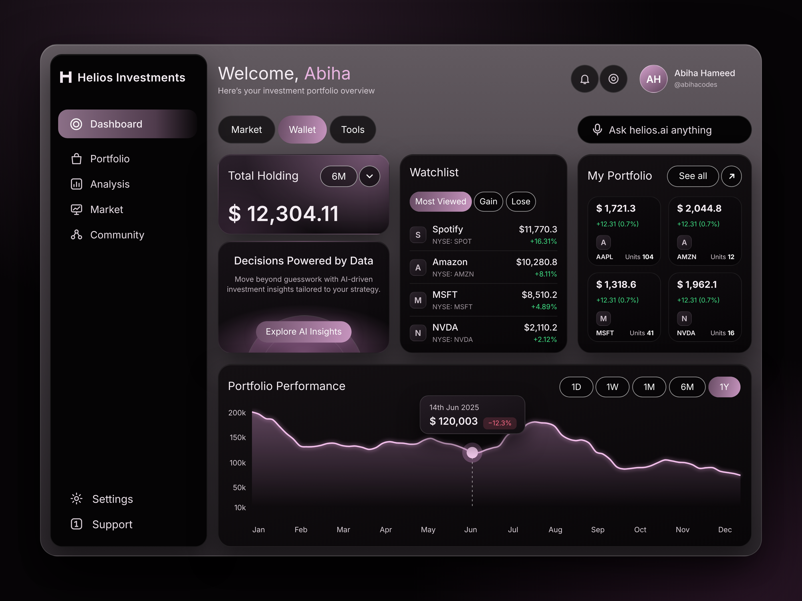
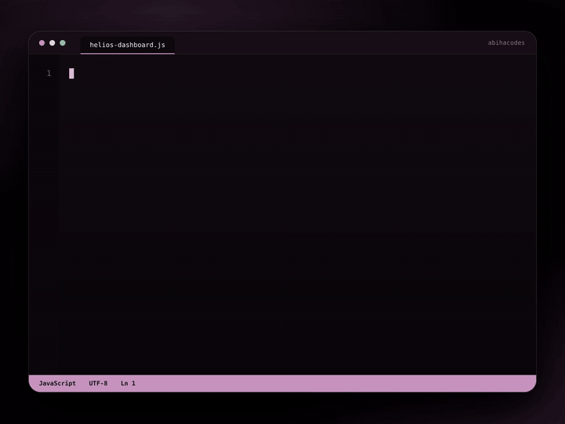

# Helios Investments · Interactive Dashboard Demo

A dark, glass-style investment dashboard built with plain HTML, CSS and JavaScript. It has glowing buttons, a chart that morphs between time ranges, a growth calculator, an AI-style search box and a personalised welcome. No frameworks and nothing to install.

**[▶ Live demo](https://abihaha7.github.io/helios-dashboard/)** · **[Watch the full video (MP4)](demo.mp4)**



## Preview



## Features

- **Glowing buttons with a soft click sound:** every button lights up and ripples when pressed.
- **Interactive chart:** switch between 1D, 1W, 1M, 6M and 1Y and watch the line morph. Move the mouse over it and the tooltip follows.
- **Watchlist filters:** Most Viewed, Gain and Lose swap the list.
- **Total Holding:** the period buttons count the balance up and down.
- **AI insights card:** tap it to cycle through sample insights.
- **Ask helios.ai:** type a question such as "how risky is my portfolio" and get a typed reply.
- **Every sidebar item opens a page:**
  - Portfolio with allocation bars
  - Analysis with a returns chart
  - Market overview
  - Community feed
  - Settings
  - Support with FAQs
  - Tools with a growth calculator
- **Notifications:** the bell opens a dropdown you can mark as read.
- **Personalised:** the dashboard greets each visitor by name and shows their ID.

## Personalise it with a link

Add a name and ID to the end of the page address and it opens ready for that person:

```
https://abihaha7.github.io/helios-dashboard/?name=Sara%20Khan&id=sara.codes
```

If no name is in the link, a welcome box asks for one. Visitors can also change it later in **Settings**.

## Run it locally

1. Download or clone this repo.
2. Open `index.html` in any browser.

That's it. It's a single file, and it has no build step.

## Built with

- HTML5 and CSS3 (glass effects, gradients, animations)
- Vanilla JavaScript (SVG chart, Web Audio click sound)
- Inter font from Google Fonts

## Notes

All names, prices and numbers are made up for demo purposes and are **not financial advice**. The layout was inspired by a Helios Investments dashboard concept. The code, data and interactions are my own.

## Author

**Abiha Hameed**, Software Engineer · Lahore, Pakistan

- GitHub: [@abihaha7](https://github.com/abihaha7)
- Portfolio: [abiha-portfolio-snowy.vercel.app](https://abiha-portfolio-snowy.vercel.app)
- LinkedIn: [Abiha Hameed](https://www.linkedin.com/in/abiha-hameed-915272369/)
- Instagram: [@abihacodes](https://instagram.com/abihacodes)

If you liked it, give the repo a ⭐

